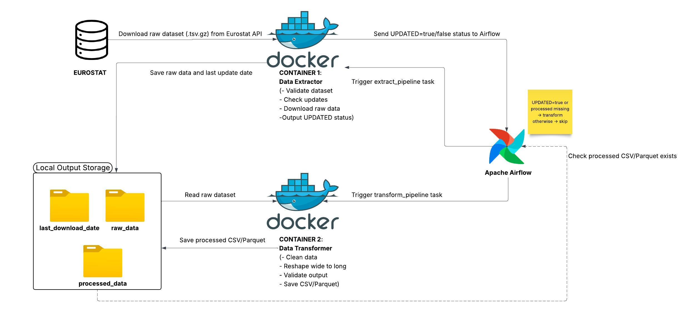
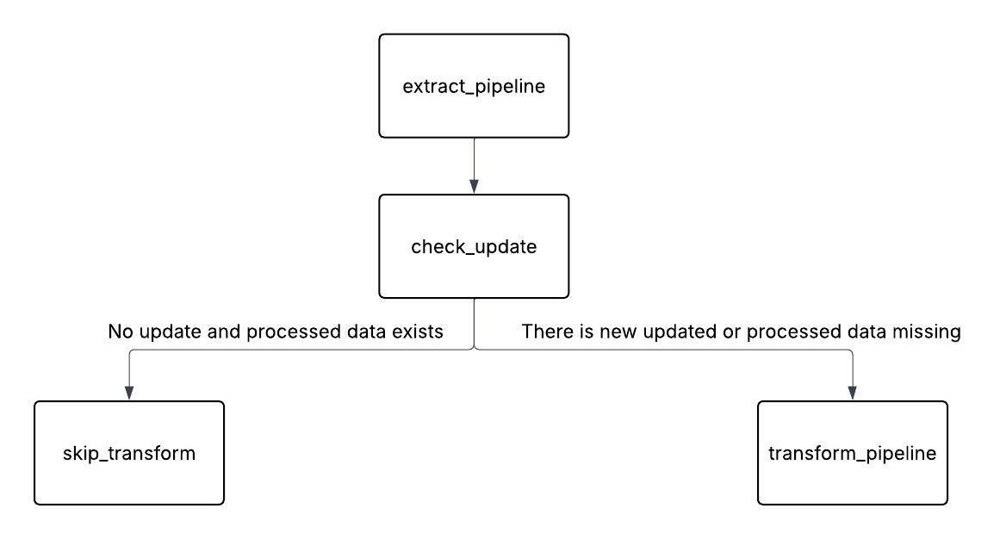

# eurostat-data-pipeline

## Project Overview
The core idea is to build an automated, cloud-based data engineering pipeline that uses Python and Docker to extract, clean, validate, and process European asylum statistics from Eurostat. 
The pipeline is designed to run on a schedule in Azure and deliver processed Parquet files to a Microsoft Fabric Lakehouse.
Using monthly asylum applications, monthly pending applications, and quarterly asylum decisions, the platform will support analysis of asylum trends, pending cases, and decision outcomes. 
The resulting datasets will enable country-level comparisons against the EU27 aggregate and provide a foundation for Power BI dashboards and time-series forecasting to explore future application trends and potential pressures on asylum systems.

---

## Project Goals

- Build an automated data pipeline to collect and process European asylum statistics from Eurostat using Python and Docker.
- Run the pipeline on a schedule in Azure and send processed Parquet files to Microsoft Fabric.
- Ensure data quality and prepare reliable datasets for analysis.
- Analyze asylum applications, pending cases, and decision outcomes across European countries, comparing country-level trends with the EU27 aggregate.
- Build Power BI dashboards and explore time-series forecasting to identify trends and potential pressures on asylum systems.

---

## Datasets

| Dataset ID | Description | Frequency |
| :--- | :--- | :--- |
| [migr_asyappctzm](https://ec.europa.eu/eurostat/databrowser/view/migr_asyappctzm/default/table) | Asylum applications | Monthly |
| [migr_asypenctzm](https://ec.europa.eu/eurostat/databrowser/view/migr_asypenctzm/default/table) | Pending asylum applications | Monthly |
| [migr_asydcfstq](https://ec.europa.eu/eurostat/databrowser/view/migr_asydcfstq/default/table) | Asylum decisions | Quarterly |

## Architecture

### Local Architecture
The local setup uses two Docker containers to keep data extraction and transformation separate. Apache Airflow is responsible for coordinating the tasks and deciding when each container should run.

The first container, eurostat-extract, connects to the Eurostat API, checks for updates using dataset metadata, and downloads the raw data when a newer version is available. It also saves the latest download date and returns an update status to Airflow.

Based on this status, Airflow checks whether new data is available or whether the processed output is missing. If an update is needed, it triggers the second container, eurostat-transform.

The transformation container reads the raw dataset, cleans the data, reshapes it from wide to long format, validates the output, and saves the processed data in CSV or Parquet format.

### Local ETL Processing Flow
The eurostat-extract container connects to the Eurostat API and checks the latest dataset update date using its metadata. It compares this date with the locally stored last_download_date to determine whether new data needs to be downloaded. When an update is available, the raw dataset is downloaded and stored locally.

Apache Airflow orchestrates the two containers and manages their execution order. After extraction, it checks whether an update was found or whether the processed output is missing. If either condition is met, it triggers the eurostat-transform container.

The transformation process reads the raw data in chunks rather than loading the entire dataset into memory. Each chunk is cleaned, transformed, validated, and then saved incrementally to Parquet. Once the full transformation finishes successfully, the last_processed_date marker is updated.

### Azure Architecture
After getting the pipeline working locally, I moved it to Azure so it could run automatically without depending on my local machine.

For this setup, I combined the extraction and transformation code into one Docker image instead of using two separate containers. I pushed the image to GitHub Container Registry (GHCR), and Azure Container Apps Job pulls it and runs the pipeline every Sunday.

The pipeline follows the same process as the local version. It checks Eurostat for new data, downloads any updates, and processes the datasets in chunks. Each chunk is cleaned and validated before being saved to Parquet.

I also set up an Azure Storage Account with an Azure File Share to store the pipeline's files. The file share is mounted inside the container, so raw data, processed Parquet files, and date markers are kept between runs rather than being lost when the container stops.

To keep track of executions, I configured Azure Monitor alerts and Log Analytics. If the job enters an unexpected state that matches the alert conditions, an email notification is sent through an Action Group.

Once the Parquet files are ready, Microsoft Fabric picks them up from Azure Files and continues the process through the Bronze, Silver, and Gold layers. The resulting Gold tables are then used by the Power BI semantic model.

**The goal was mainly to learn how to deploy and run the pipeline in the cloud, rather than redesign it for maximum scalability. The current version still processes chunks sequentially inside one container. This works for the current datasets, but a distributed solution like Spark would be more suitable for larger workloads. So, future improvements will use distributed processing with Apache Spark and temporary Parquet files to improve scalability and protect existing output when a processing run fails.**

### Fabric Architecture
---

## Pipeline Flow
### 1. Extract Step
The `extract_pipeline` task runs the Dockerized extract container for the selected Eurostat dataset.

The Extractor container: 
- Validates the dataset name and handles empty/null input
- Retrieves the latest update date from Eurostat
- Compares the latest update date with the locally stored date:
* If there is no locally stored date -> Downloads the raw dataset in archived `.tsv.gz` format -> Save the update date from Eurostat locally -> Outputs an update status as the final line (UPDATED=true)
* If the locally stored date is older than the latest Eurostat update date -> Downloads the raw dataset in archived `.tsv.gz` format -> Save the update date from Eurostat locally -> Outputs an update status as the final line (UPDATED=true)
* If the locally stored date equals the latest Eurostat update date -> Skip the download -> Outputs an update status as the final line (UPDATED=false)
* Prints the update status as the final output line for Airflow to retrieve through XCom.

| Condition | Action | Output |
|---|---|---|
| No locally stored update date exists | Download the dataset and save the update date after a successful download. | `UPDATED=true` |
| The stored date is older than Eurostat’s latest update date | Download the updated dataset and save the new update date after a successful download. | `UPDATED=true` |
| The stored date matches Eurostat’s latest update date | Skip the download. | `UPDATED=false` |

Airflow uses the UPDATED status to determine whether the Transform step should run.

### 2. Update Check 
This task reads the extract status from XCom (UPDATED=false/UPDATED=true) and checks whether the processed CSV and Parquet files already exist, as follows:
* If UPDATED=true -> perform transform_pipeline task
* If the processed output files are missing -> perform transform_pipeline task
* If UPDATED=false and processed output files exist -> Skip transform_pipeline task

### 3. Transform Step
The transform_pipeline task runs the Dockerized transform container.
During this step, the container:
- Reads the raw .tsv.gz dataset that was downloaded from extract_pipeline
- Splits Eurostat dimension columns
- Converts the dataset from wide format to long format
- Cleans numeric values and extracts Eurostat flags
- Applies specific filtering
- Adds country names
- Runs validation checks using the `DataValidator` class to verify that required columns exist, specified columns do not contain null values, metric values are non-negative, and the time period follows the expected format.
- Renames the numeric metric column according to the dataset:
  - `applicant_count`: Number of asylum applications.
  - `pending_count`: Number of pending asylum applications.
  - `decision_count`: Number of asylum decisions.
  Each dataset uses its corresponding metric column to represent the measured values.
- Saves the transformed output as CSV and Parquet

### 4. Skip Step
If the dataset is already up to date and the processed output files exist, Airflow runs the skip_transform task.

### Pipeline Flow Summary Diagram

---

## Local Pipeline Status

The local Docker and Airflow pipeline has been tested successfully with the following scenarios:

- First run with missing raw, processed, and metadata files
- No update with existing processed files
- Missing processed output files
- Missing raw data file
- Missing last download date file
- Invalid dataset handling
- Standalone Docker container execution
- Airflow DAG execution for all configured datasets

---

## Azure Deployment
The pipeline has been deployed to Azure using Azure Container Apps Jobs and a Docker image hosted in GitHub Container Registry.

### Azure Resources
| Resource | Name |
| :--- | :--- |
| **Resource Group** | `rg-eurostat-pipeline-dev` |
| **Container Apps Environment** | `cae-eurostat-pipeline-wp` |
| **Container Apps Job** | `eurostat-pipeline-job` |
| **Storage Account** | `eurostatpipe0255` |
| **Azure File Share** | `eurostat-output` |
| **Container Image** | `ghcr.io/3boood97/eurostat-pipeline:v0.1.0` |

### Container Execution
The Azure Job uses the Docker image from GitHub Container Registry.
The image contains the Python extraction and chunked transformation components, along with their required dependencies.
The pipeline orchestrator, src/main_pipeline.py, runs extraction first and transformation second for the selected dataset. 

### Storage
The storage contains the following directories:
| Directory | Purpose |
| :--- | :--- |
| `raw` | Downloaded source datasets |
| `processed` | Processed Parquet datasets |
| `last_download_date` | Stored source download dates |
| `last_processed_date` | Stored processing dates |

---

## Dashboard Visuals

### Executive Summary Report
Executive summary and key general indicators.

### Applications Report
Analyzing the asylum trends and the distinction between first-time and SSEQ (Subsequent Applicant)

### Decisions & Recognition Rates Report
Asylum decisions and recognition rates

### Pending Report
Pending cases and a snapshot of the most recent monthly records.

