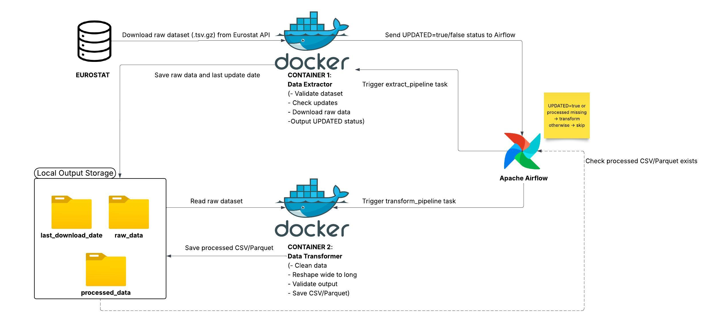
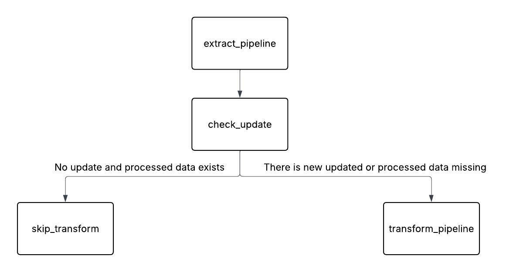

# eurostat-data-pipeline

## Project Overview
The core idea is to build an automated, cloud-based data engineering pipeline that uses Python and Docker to extract, clean, validate, and process European asylum statistics from Eurostat. 
The pipeline is designed to run on a schedule in Azure and deliver processed Parquet files to a Microsoft Fabric Lakehouse.
Using monthly asylum applications, monthly pending applications, and quarterly asylum decisions, the platform will support analysis of asylum trends, pending cases, and decision outcomes. 
The resulting datasets will enable country-level comparisons against the EU27 aggregate and provide a foundation for Power BI dashboards and time-series forecasting to explore future application trends and potential pressures on asylum systems.

---

## Project Goals

- Build an automated data pipeline to collect and process European asylum statistics from Eurostat using Python and Docker.
- Run the pipeline on a schedule in Azure and send processed Parquet files to Microsoft Fabric.
- Ensure data quality and prepare reliable datasets for analysis.
- Analyze asylum applications, pending cases, and decision outcomes across European countries, comparing country-level trends with the EU27 aggregate.
- Build Power BI dashboards and explore time-series forecasting to identify trends and potential pressures on asylum systems.

---

## Current-State Architecture Diagram

---

## Pipeline Flow
### 1. Extract Step
The `extract_pipeline` task runs the Dockerized extract container for the selected Eurostat dataset.

The Extractor container: 
- Validates the dataset name and handles empty/null input
- Retrieves the latest update date from Eurostat
- Compares the latest update date with the locally stored date:
* If there is no locally stored date -> Downloads the raw dataset in archived `.tsv.gz` format -> Save the update date from Eurostat locally -> Outputs an update status as the final line (UPDATED=true)
* If the locally stored date is older than the latest Eurostat update date -> Downloads the raw dataset in archived `.tsv.gz` format -> Save the update date from Eurostat locally -> Outputs an update status as the final line (UPDATED=true)
* If the locally stored date equals the latest Eurostat update date -> Skip the download -> Outputs an update status as the final line (UPDATED=false)
* Prints the update status as the final output line for Airflow to retrieve through XCom.

| Condition | Action | Output |
|---|---|---|
| No locally stored update date exists | Download the dataset and save the update date after a successful download. | `UPDATED=true` |
| The stored date is older than Eurostat’s latest update date | Download the updated dataset and save the new update date after a successful download. | `UPDATED=true` |
| The stored date matches Eurostat’s latest update date | Skip the download. | `UPDATED=false` |

Airflow uses the UPDATED status to determine whether the Transform step should run.

### 2. Update Check 
This task reads the extract status from XCom (UPDATED=false/UPDATED=true) and checks whether the processed CSV and Parquet files already exist, as follows:
* If UPDATED=true -> perform transform_pipeline task
* If the processed output files are missing -> perform transform_pipeline task
* If UPDATED=false and processed output files exist -> Skip transform_pipeline task

### 3. Transform Step
The transform_pipeline task runs the Dockerized transform container.
During this step, the container:
- Reads the raw .tsv.gz dataset that was downloaded from extract_pipeline
- Splits Eurostat dimension columns
- Converts the dataset from wide format to long format
- Cleans numeric values and extracts Eurostat flags
- Applies specific filtering
- Adds country names
- Runs validation checks using the `DataValidator` class to verify that required columns exist, specified columns do not contain null values, metric values are non-negative, and the time period follows the expected format.
- Renames the numeric metric column according to the dataset:
  - `applicant_count`: Number of asylum applications.
  - `pending_count`: Number of pending asylum applications.
  - `decision_count`: Number of asylum decisions.
  Each dataset uses its corresponding metric column to represent the measured values.
- Saves the transformed output as CSV and Parquet

### 4. Skip Step
If the dataset is already up to date and the processed output files exist, Airflow runs the skip_transform task.

### Pipeline Flow Summary Diagram

---

## Local Pipeline Status

The local Docker and Airflow pipeline has been tested successfully with the following scenarios:

- First run with missing raw, processed, and metadata files
- No update with existing processed files
- Missing processed output files
- Missing raw data file
- Missing last download date file
- Invalid dataset handling
- Standalone Docker container execution
- Airflow DAG execution for all configured datasets

The local pipeline is stable for local execution. The next step is to implement and test cloud storage integration.
